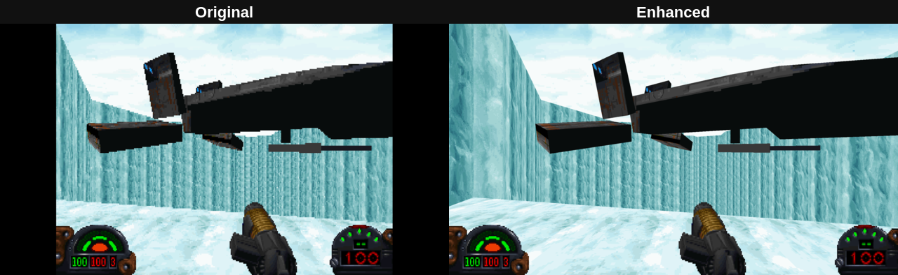
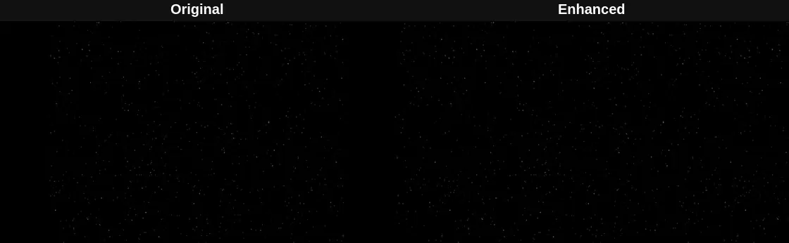
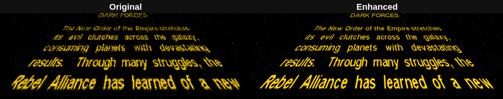

jaidi
=====

*A reimplementation of the Dark Forces engine, written in Jai.*

[](https://github.com/joeriedel/jaidi/releases/latest) [](COPYING) [](#playing-it) [](#building-it)


> Dark Forces is one of my formative experiences as a child: it's a big part of why I fell in love with games, and with the technology under them (that and a heavy dose of DOOM). That love became a career. I've been making games for over 25 years now, and I've written a few engines of my own along the way.
>
> jaidi is my way of keeping Dark Forces alive. To me, preserving a game means you can still just sit down and play it: on the computer you have, without DOSBox, at your screen's resolution, with nothing to set up.
>
> It's a homage to the original Dark Forces Jedi engine, written from scratch in Jai, Jonathan Blow's programming language. It plays the original game's own files exactly as they were released, and alongside that an Enhanced mode that respects the original. **F12** switches between them at any time.
>
> — Joe

How it was built
----------------

I have been messing around with remaking Dark Forces for like 15 years, and I never really had the time to fully do it. To me, Jai is the best language ever made and I am into agentic programming. So with Claude, Df_specs.hlp, DARK.EXE, and my experience building games for two decades I was able to build this in only a few days. Interesting times we live in.

I am aware of the TFE project and I am a big fan but I always had issues getting it to work reliably and it has a lot of configuration. I just wanted something turn-key, simple, and more modern than DOSBox mode 13 graphics.

Playing it
----------

jaidi plays your own copy of Dark Forces. There's nothing to install or set up:

1. Unpack jaidi wherever you like.
2. Copy the contents of your Dark Forces folder (the one with **DARK.GOB**, **SOUNDS.GOB**, **TEXTURES.GOB**, **SPRITES.GOB** and the **LFD** folder) into the **DARK** folder inside the jaidi folder.
3. Run **jaidi.exe** on Windows, or **./jaidi** on Linux.

It should play as the original did.

jaidi comes with none of the game's content: no levels, art, sounds, music or cinematics. You need the files from a copy of Dark Forces you own: the [GOG](https://www.gog.com/en/game/star_wars_dark_forces) or [Steam](https://store.steampowered.com/app/32400/) release, or the original CD.

| File | What's in it |
|------|--------------|
| DARK.GOB | levels, palettes, messages |
| TEXTURES.GOB | wall, floor and ceiling textures |
| SPRITES.GOB | enemies, items and effects |
| SOUNDS.GOB | sound effects and music |
| LFD/ | menus, briefings and cinematics |

### On Windows

- The first time, run **vc_redist.x64.exe** (Microsoft's Visual C++ runtime; skip it if you already have it).
- jaidi isn't signed, so Windows may say "Windows protected your PC" the first time: click **More info**, then **Run anyway**.
- Agents (your saved players) are kept in `%APPDATA%\jaidi\DARKPILO.CFG`.
- You need Vulkan graphics drivers, which any reasonably recent NVIDIA, AMD or Intel driver includes.

### On Linux

- Unpack it with `tar xzf jaidi-*-linux-x86_64.tar.gz`.
- Agents are kept in `~/.local/share/jaidi/DARKPILO.CFG`.
- You need Vulkan drivers: Mesa's for AMD and Intel, which a desktop install has already, or NVIDIA's own driver. `vulkaninfo --summary` (in vulkan-tools) shows whether Vulkan works.
- It needs glibc 2.31 or newer (Ubuntu 20.04, Debian 11 and later).
- It uses Wayland when the desktop runs it; if the window or the input misbehaves, try `./jaidi --x11` to use X11 instead.

What works so far
-----------------

Each mission plays in order, with the cinematic before it, its briefing, the level, and the cinematic after it.

The whole game plays, every enemy and boss included. Not there yet: settings and configuration screens.

### Keys

| Anywhere | |
|----------|---|
| F11 | fullscreen on or off |
| F12 | Enhanced mode on or off (see below) |

| In a level | |
|------------|---|
| WASD and the mouse | move and look |
| Arrows, Alt + arrows | turn, strafe |
| Shift / Caps Lock | run / walk |
| Space, C | jump, crouch |
| E or Enter | use (doors, switches) |
| Ctrl, Z | fire, secondary fire |
| Mouse buttons | left fire, right use, middle secondary fire |
| 1 to 0 | weapons |
| F8 | holster the weapon, or bring it back |
| F9, F10 | previous and next weapon |
| Backspace | back to the weapon held before |
| Alt + F8 | switch weapons by themselves when one runs out of ammo |
| F1 | PDA (map, inventory, goals, briefing) |
| F2, F3, F4 | goggles, ice cleats, gas mask |
| F5 | headlamp |
| Tab, Alt + Tab | map over the view, all layers |
| `=`, `-` | zoom the map |
| `[`, `]` | map layer down, up |
| `` ` `` + arrows | scroll the map |
| Esc | the game's menu (abort, next mission, quit) |

In cinematics, Esc or Enter skips, and Space goes to the next scene.

Enhanced mode
-------------

Enhanced mode is on by default; **F12** turns it off and on at any point.

In the levels, it draws the 3D view at your screen's full resolution instead of 320x200, across the whole width of a widescreen display.



Most of what it does is in the cinematics: the opening, and the films before and after each mission. They play with the same timing, sound and music, but each frame is redrawn at your screen's resolution:

- **Smooth motion.** The original moves everything in whole-pixel steps, once per frame of the film. Enhanced mode glides everything between those steps, to fractions of a pixel, at your display's frame rate, so ships, planets and logos move smoothly instead of shuffling.
- **In-between frames.** Where the original flips through frames of animation (a planet turning, the Star Wars logo shrinking away), Enhanced mode adds new frames between them, so the animation flows instead of stepping.
- **Upscaled art.** The art is upscaled as it's drawn, with smooth curves and crisp, round outlines instead of big blocky pixels.
- **A sharper crawl.** The opening text crawl is drawn at your screen's resolution.
- **Smooth fades.** The original fades its palette in 32 steps; Enhanced mode fades continuously, with no banding.
- **Widescreen.** The films were framed for a 4:3 screen. Enhanced mode fills a 16:9 screen: star fields carry on into the sides, art the original cut off at the screen's edge carries on past it, and scenes that would leave a gap are drawn a little larger.





Building it
-----------

jaidi is written in Jai, Jonathan Blow's programming language. Jai is in closed beta and can't be passed on with jaidi, so to build it you need your own copy.

**What you need:**

- **Jai 0.2.030**, unpacked as `jai/` in the source folder, so that `jai/bin/jai-linux` (`jai\bin\jai.exe` on Windows) is there.
- That's all: the libraries jaidi uses come with the source in `modules/engine/vendor`, with their shared libraries already built (SDL 3.4.8, Dear ImGui 1.92.8 docking, Nuked OPL3), and the renderer's shaders are compiled to SPIR-V and checked in.

From the source folder:

```sh
jai/bin/jai-linux first.jai                          # a dev build, bin/jaidi, with the tools
jai/bin/jai-linux first.jai - release                # optimized
jai/bin/jai-linux first.jai - release ship           # as released: no tools, fullscreen
jai/bin/jai-linux first.jai - release ship windows   # bin/windows/jaidi.exe, cross-compiled
jai/bin/jai-linux first.jai - check                  # type-check only
jai/bin/jai-linux tests.jai                          # the tests
```

On Windows it's `jai\bin\jai.exe first.jai`, with Visual Studio's C++ tools installed. The cross-compiled Windows build needs the MSVC runtime and Windows SDK libraries, unpacked with [xwin](https://github.com/Jake-Shadle/xwin) into `/opt/xwin` or the folder `XWIN` names.

Dev builds read the game from a folder named `dark` in the source folder (a copy of your Dark Forces folder); release ship builds from `DARK` beside the executable. The tests that need the game's files skip when `dark` is missing.

### The dev container

`docker/` holds the podman container jaidi is made in: the Steam Runtime 4 SDK, with Neovim and the Jails language server. With `jai/` in place, run `docker/build.sh`, then `docker/run.sh`, from the source folder. It mounts the source folder at the same path, and the display, the GPU and the sound, so jaidi runs from inside it. On NVIDIA, install nvidia-container-toolkit and run `sudo nvidia-ctk cdi generate --output=/etc/cdi/nvidia.yaml` once (again after driver updates).

License
-------

jaidi is free software, licensed under the GNU General Public License, version 2 or (at your option) any later version (GPL-2.0-or-later); see [COPYING](COPYING). That license covers jaidi's own code. The libraries it uses keep their own licenses, in `licenses/` in the release packages and with their source in `modules/engine/vendor`: SDL (zlib), Dear ImGui (MIT), Nuked OPL3 (LGPL-2.1-or-later).

Star Wars and Dark Forces are trademarks of Lucasfilm Ltd., and the original game is copyrighted by its owners. jaidi isn't affiliated with or endorsed by Lucasfilm, LucasArts, Disney or any of their licensees.
